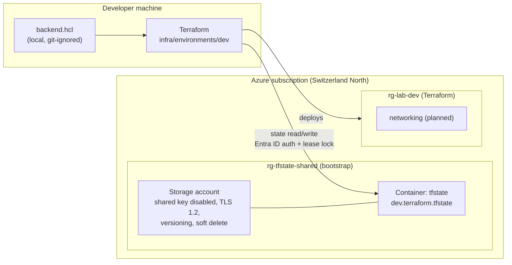

# azure-landing-zone-lab

A hands-on lab for building a small **Azure landing zone** with **Terraform**, **GitHub Actions** and **PowerShell/Python**, following the same practices used in real platform teams. Every change goes through an issue, a feature branch and a reviewed pull request.

> **Status:** Terraform remote state is in place and the `dev` environment is connected to it. Next up: the first reusable module (networking).

## Goals

- Infrastructure as Code with Terraform (`azurerm` provider) for Azure
- Secure remote state with Entra ID authentication, locking and versioning
- CI/CD with GitHub Actions and OIDC (no client secrets)
- Security gates: secret scanning, linting and tests
- Tooling in PowerShell and Python, with Pester and pytest

## Architecture (current)



**State backend:** The storage account that holds the Terraform state is bootstrapped once with the Azure CLI. It cannot be created by the Terraform configuration that uses it as its backend. Hardening:
- Shared key access is disabled, so authentication works only through Entra ID.
- Minimum TLS 1.2 and HTTPS only.
- No public blob access.
- Blob versioning, plus soft delete for blobs and containers (14 days).
- Access is granted through `Storage Blob Data Contributor`, scoped to the storage account only.

## Repository structure

```
.
├── .github/
│   ├── CODEOWNERS
│   └── workflows/              # GitHub Actions (planned)
├── docs/                       # Documentation, diagrams, ADRs
├── infra/
│   ├── environments/
│   │   └── dev/                # Root module for the dev environment
│   └── modules/                # Reusable Terraform modules (planned)
├── scripts/
│   ├── powershell/             # PowerShell tooling (planned)
│   └── python/                 # Python tooling (planned)
├── .gitattributes              # LF line endings for all text files
├── .gitignore
└── .pre-commit-config.yaml     # gitleaks secret scanning
```

## Getting started

### Prerequisites

- [Terraform](https://developer.hashicorp.com/terraform/install) >= 1.9
- [Azure CLI](https://learn.microsoft.com/cli/azure/install-azure-cli)
- [pre-commit](https://pre-commit.com/) and [gitleaks](https://github.com/gitleaks/gitleaks)
- An Azure subscription and the role `Storage Blob Data Contributor` on the state storage account

### First-time setup

```bash
git clone git@github.com:EminEminEmin92/azure-landing-zone-lab.git
cd azure-landing-zone-lab
pre-commit install            # activates secret scanning for this clone
az login
```

### Working with the dev environment

```bash
cd infra/environments/dev
cp backend.hcl.example backend.hcl                              # then set storage_account_name
export ARM_SUBSCRIPTION_ID=$(az account show --query id -o tsv) # never committed
terraform init -backend-config=backend.hcl
terraform plan
```

Real values (subscription ID, storage account name) never live in the repository. They come from the local `backend.hcl` (git-ignored) and from environment variables.

## Conventions

- **Branches:** `feat/`, `fix/`, `docs/`, `chore/`. Nothing is committed directly to `main`.
- **Commits and PR titles:** [Conventional Commits](https://www.conventionalcommits.org/) (`feat:`, `fix:`, `docs:`, `chore:`).
- **Pull requests:** What, Why, How tested, linked to an issue (`Closes #N`), squash-merged.
- **`main` is protected:** PR required, linear history, no force pushes, no deletion.
- **Naming:** `rg-<workload>-<env>`, `vnet-<workload>-<env>`, `snet-<name>`.
- **Region:** `switzerlandnorth`.
- **Mandatory tags:** `workload`, `environment`, `managed_by`.

## Security

- **Secret scanning:** gitleaks runs as a pre-commit hook. It was verified with a fake Entra ID client secret, and the commit was blocked.
- **Git-ignored files:** `*.tfstate`, `*.tfvars` and `backend.hcl`.
- **Commit email:** commits use the GitHub noreply address.
- **CI/CD (planned):** authentication through OIDC / workload identity federation, without client secrets.

## Roadmap

**Done**
- Repository setup, branch protection, `.gitignore`, `.gitattributes`
- Secret scanning with gitleaks (pre-commit)
- Remote state backend in Azure (Entra ID auth, locking, versioning)
- `dev` root module with a first resource group

**Next**
- Networking module (VNet, subnets, NSG)
- Bootstrap script for the state backend in PowerShell 7 (#8)
- GitHub Actions pipeline: `fmt`/`validate`/`plan` on PRs, `apply` after merge, approval gate for prod, OIDC login
- Security gates: Checkov, PSScriptAnalyzer, Pester, pytest
- Key Vault, storage, VM
- PowerShell and Python tooling with tests
